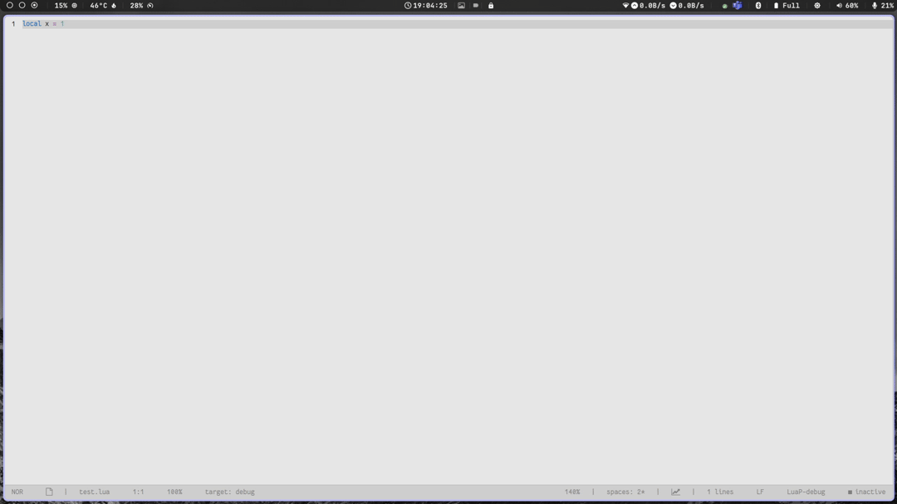

# Lite MODAL

A fully customizable modal editing experience for Lite Xl




## Configuration

The configuration of the modal experience can be done via the follow parameters:

| field | default | comment |
|:------|:-------:|:--------| 
|`modal.base_mode`| `nil` | default mode when opening a new document/session |
|`modal.modes` | `{}` | enumerate all the possible modes available |
|`modal.keymaps` | `{}` | table containing keymaps for each available mode |
|`modal.on_key_callbacks` | `{}` | table containing `on_key_pressed` callbacks for each mode |
|`modal.carets` | `{}` | carets styles for each mode |
|`modal.helpers` | `{}` | available command helpers per mode |
|`modal.config.helper.show` | `true` | enable or disable command helper |


Additionally the helper styling can be changed:

| field | default | comment |
|:------|:-------:|:--------| 
|`style.helper.background` | `#000000C8` | helper background color |
|`style.helper.text` | `#FFFFFFDC` | helper text color |
|`style.helper.padding` | 10 | helper internal padding |
|`style.helper.margin` | 10 | helper external margin |
|`style.helper.alignement` | `modal.align.LEFT` | helper alignement |

### Configuration details

It is possible to configure any number of modes in the `modal.modes` table, for example:

```lua
modal.modes = {NORMAL=1, INSERT=2, VISUAL=3}
```
Then you should decide wich mode is the base/default mode for example:

```lua
modal.base_mode = modal.modes.NORMAL
```

Then decide which kind of `on_key_pressed` call back to use (*or define your owns*):

```lua
modal.on_key_callbacks[modal.modes.NORMAL] = modal.on_key_command_only
modal.on_key_callbacks[modal.modes.INSERT] = modal.on_key_passtrought
modal.on_key_callbacks[modal.modes.VISUAL] = modal.on_key_command_only
```

The callback `on_key_command_only` will only register the keystrokes and execute
the matched commands but will not forward the strokes to `lite-xl`. This will allow to 
reproduce most modal editing stuff.

The callback `on_key_passtrought` will register the keystrokes and execute commands (if matched)
and will pass the strokes to `lite-xl`, usefull for *editing* modes.

You can define your own logics if you want something different.

Lastly you have to define the keymaps for the different modes:

```lua
modal.keymaps[modal.modes.NORMAL] = {
  ["i"] = modal.go_to_mode(modal.modes.INSERT), -- function call back
  ["v"] = modal.go_to_mode(modal.modes.VISUAL),
  ["u"] = "doc:undo",
  ["<left>"] = {"doc:move-to-previous-char", "dialog:previous-entry"},
  ["j"] = "doc:move-to-next-line",
  ["<space>f"] = "core:open-file",
  ["P"] = "jp", -- other sequence 
  -- .....
}
modal.keymaps[modal.modes.INSERT] = {
  ["<ESC>"] = modal.go_to_mode(modal.modes.NORMAL),
}
-- ...
```

Each sequence can execute one or more commands, the commands can be functions or string.
If it is a string and it match another sequence, the sequence command is executed, otherwise 
it will execute as a `lite-xl` command.

**TODO** : implement correctly the sequence executer.

Optionally it is possible to configure additional features: 
```lua
-- define BAR caret
modal.carets[modal.modes.NOR] = modal.caret_style.BAR

-- helper definition
modal.helpers[modal.modes.NOR] = {
  ["<space>"] = {
    {"f", "open file picker"},
    {"P", "open project picker"},--...
  }
}
```

### Helix Style Preset

An [helix](helix-editor.com) style configuration is provided and to enable simply add the following to
you `lite-xl` `init.lua` file:

```lua
local modal_hx = require "plugins.modal.hx_style"
```


## Installation

Simply clone this repo into your `lite-xl` as follow:

```
cd ~/.config/lite-xl/
git clone https://codeberg.org/Mandarancio/lite-modal.git plugins/modal
```
