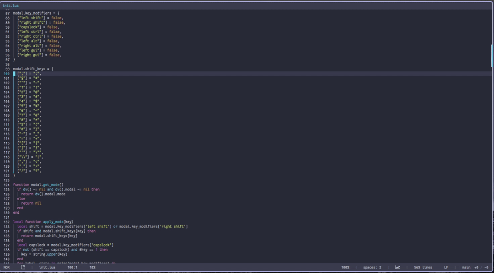

# MODAL-hx

Helix style modal editing for Lite XL

## Dependencies

Please be sure to have the following plugins installed:

 - [`modal`]()
 - [`previewer`]()
 - [`lsp`]()
 - [`lintplus`]()
 - [`buffers`]()
 - [`gitproject`]()

## Keymap

Please make reference to the [helix keymap](https://docs.helix-editor.com/keymap.html)

Below some differences:

 - `w` and `e` as well as `W` and `E` do the same thing: move to next word/WORD end
 - Instead of `Alt-.` (that repeat last motion action), `.` repeat any action (like vi)
 - The following key binding are not implemented: 
  - `Ctrl-*`
  - `~`
  - `\``, `Alt-\``
  - `Alt-u`, `Alt-U`
  - `"<reg>`
  - `=`
  - `q`, `Q`
  - and more ...

